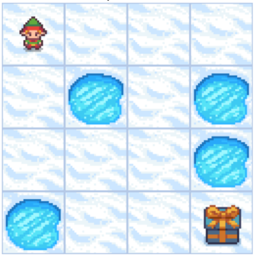
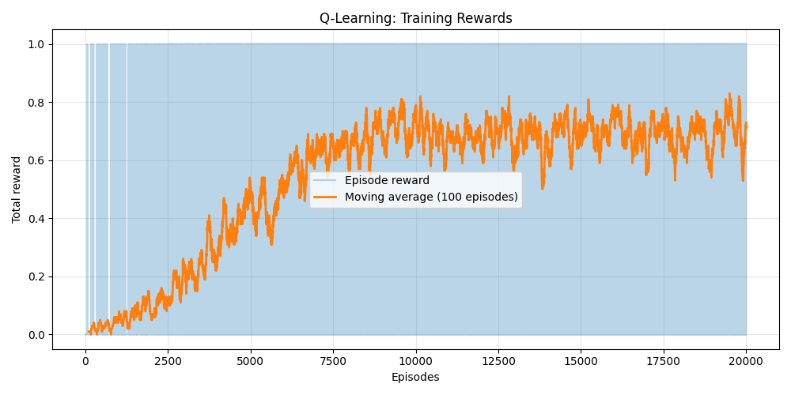
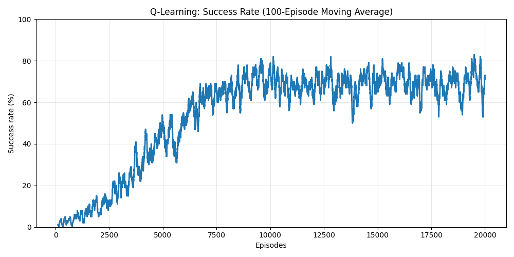

# $\color{#0081A5}{\textsf{\textbf{Learning to Navigate: A Reinforcement Learning Project with Q-Learning on FrozenLake}}}$

This project explores **Reinforcement Learning (RL)** through a simple navigation task using the FrozenLake environment from [Gymnasium](https://gymnasium.farama.org/).

The goal is to train an agent to navigate a grid, reach a destination, and avoid falling into holes. Instead of telling the agent which actions to take, we let it learn through interaction with the environment, using rewards as feedback.

- The project starts with a random agent as a baseline and then introduces **Q-Learning**, a value-based reinforcement learning algorithm.

 

## $\color{#FF6F00}{\textsf{\textbf{Project Objectives}}}$

The project is divided into five main steps:

| # | Step |  Description |
|:-:|---|---|
| 1️⃣ | **Environment Setup**  | Create and configure FrozenLake |
| 2️⃣ | **Understanding the MDP**  | Inspect states, actions, transitions, rewards |
| 3️⃣ | **Random Agent**  | Baseline with random actions |
| 4️⃣ | **Q-Learning**  | Implement and train the agent |
| 5️⃣ | **Evaluation & Visualization** | Test the policy and plot results |

 

## $\color{#FF6F00}{\textsf{\textbf{The Environment: FrozenLake}}}$

FrozenLake-v1 is a classic grid-world environment that can be modeled as a **Markov Decision Process (MDP)**.

The agent must navigate from a **starting position (S)** to a **goal (G)**, avoiding **holes (H)** and moving only across **frozen tiles (F)**.

  

### $\color{#2E8B57}{\textsf{\textbf{FrozenLake as an MDP}}}$

Before implementing an agent, we need to understand how the environment works mathematically.

A Markov Decision Process is represented by:

$$MDP = (S, A, P, R, \gamma)$$

- **States (S):** The agent's possible positions, represented by integers from 0 to 15.
- **Actions (A):** Four possible movements:
  - ⬅️ Left (0)
  - ⬇️ Down (1)
  - ➡️ Right (2)
  - ⬆️ Up (3)
- **Transition probabilities (P):** The probability of reaching a new state given the current state and chosen action.
- **Rewards (R):** Feedback received after taking an action.
- **Discount factor (γ):** Determines how much importance the agent gives to future rewards.

### $\color{#2E8B57}{\textsf{\textbf{Deterministic vs. Stochastic Environments}}}$

There are two ways the environment can behave:

- **Deterministic:** An action always produces the same transition.
- **Stochastic:** An action can lead to different outcomes due to randomness.

In FrozenLake, setting `is_slippery=True` introduces uncertainty into movement. For example, choosing to move right does not guarantee that the agent will move right.

### $\color{#2E8B57}{\textsf{\textbf{Rewards and Episode Termination}}}$

We use the following reward configuration:

| Event | Reward |
|---|---:|
| Reach the goal (G) | +1 |
| Fall into a hole (H) | 0 |
| Move onto a frozen tile (F) | 0 |

An episode terminates when :
- The agent reaches the **goal $G$**.
- The agent reaches a **hole $H$**.

 

## $\color{#FF6F00}{\textsf{\textbf{Q-Learning: Teaching the Agent to Learn}}}$

Until now, our random agent selected actions without learning anything from previous experiences.

With Q-Learning, the agent gradually learns which actions are better in each state.

### $\color{#2E8B57}{\textsf{\textbf{1. The Q-Table}}}$

- Imagine the agent is at state 0. It has four possible actions: Left, Down, Right, and Up.
- Initially, the agent doesn't know which action is best.
- We introduce a **Q-Table** to store the estimated value of each state-action pair.
- For FrozenLake (16 states and 4 actions), the Q-Table has the following dimensions:

$$Q(s,a) \rightarrow 16 \times 4$$

- We initialize all values to zero:

For example:

| State | Left | Down | Right | Up |
|---|---:|---:|---:|---:|
| 0 | 0 | 0 | 0 | 0 |
| 1 | 0 | 0 | 0 | 0 |
| ... | ... | ... | ... | ... |
| 15 | 0 | 0 | 0 | 0 |

- As the agent interacts with the environment, it updates these values.

> A higher Q-value means the agent estimates that taking a particular action from a given state is more valuable.

### $\color{#2E8B57}{\textsf{\textbf{2. The Q-Learning Update Rule}}}$

The central equation of Q-Learning is:

$$
Q(s,a) \leftarrow Q(s,a) +
\alpha \left[
r+\gamma\max_{a'}Q(s',a')-Q(s,a)
\right]
$$

Where:
- **s:** Current state.
- **a:** Action taken.
- **r:** Reward received.
- **s':** Next state.
- **α:** Learning rate.
- **γ:** Discount factor.
- **max Q(s', a'):** Highest estimated future action value.

The idea is simple: the agent updates its estimate of an action based on the reward it receives and the best estimated future value from the next state.

### $\color{#2E8B57}{\textsf{\textbf{3. Exploration vs. Exploitation}}}$

There is a problem: if the agent always chooses the action with the highest Q-value, how will it discover better actions?

We solve this using **ε-greedy action selection**.

- **Exploration:** Choose a random action to discover new possibilities.
- **Exploitation:** Choose the action with the highest Q-value based on current knowledge.

During training, the exploration rate (ε) gradually decreases, allowing the agent to rely more on what it has learned.

 

## $\color{#FF6F00}{\textsf{\textbf{Training Results Evaluation}}}$

The agent was trained for **20,000 episodes** using the stochastic FrozenLake environment.

We monitor its learning progress using two plots:

### $\color{#2E8B57}{\textsf{\textbf{1. Training Rewards}}}$

- **Initial learning:** During the first episodes, the average reward stays close to zero. The agent has not learned how to reach the goal yet.
- **Learning progress:** As training continues, the average reward increases. The agent learns which actions help it reach the goal.
- **Stabilization:** After around 8,000 episodes, the curve becomes more stable, fluctuating around 0.65–0.75. This shows that the agent has learned a good path to the goal, although its performance still varies.

### $\color{#2E8B57}{\textsf{\textbf{2. Success Rate}}}$

- **Slow start (0–2,000 episodes):** The success rate stays below 10%. The agent is still learning and rarely reaches the goal.
- **Improvement (2,000–8,000 episodes):** The success rate increases to around 65% as the agent learns better actions.
- **Stabilization (8,000–20,000 episodes):** The success rate stays around 65–75%, with a peak near 83%.
- **Remaining failures:** The agent does not always reach the goal because the slippery ice can randomly change its movements, even when it chooses the correct action.

 

## $\color{#FF6F00}{\textsf{\textbf{Further Experiments}}}$

Possible extensions to this project include:

1. Experiment with different learning rates and discount factors.
2. Compare deterministic and stochastic FrozenLake environments.
3. Investigate different exploration decay strategies.
4. Implement SARSA and compare it with Q-Learning.
5. Explore Deep Q-Networks (DQN) for environments with larger state spaces.

 

---